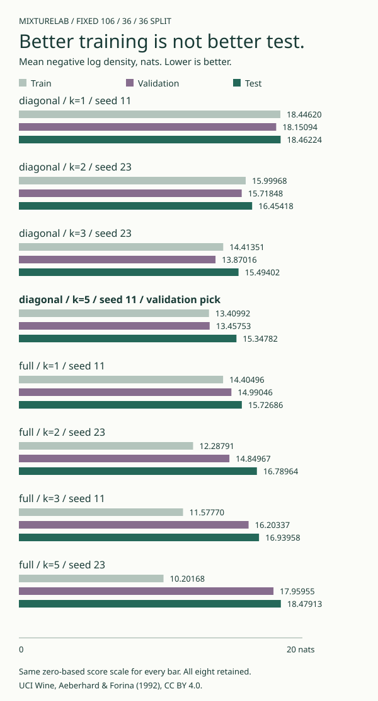

# MixtureLab

**Manual Gaussian-mixture EM. A rising likelihood is not a discovered category.**

[Interactive inspector](https://midya8.github.io/mixturelab/) · [Equations and protocol](METHOD.md) · [Complete report](mixturelab/artifacts/report.json) · [Tests](tests)

Fit a real 13-dimensional density from public chemical measurements. Edit any feature in the browser and recompute the component posterior using a separate scalar JavaScript implementation. No sklearn mixture estimator, model API, downloaded weights, private dataset or classification claim.

## What is implemented

- Log-space E-steps and weighted mean/covariance M-steps in NumPy.
- Full and diagonal covariance models, with an explicit minimum covariance eigenvalue of 0.05 in squared standardized units. Full covariance uses spectral clipping, not an added diagonal ridge.
- A numerical witness for every iteration: likelihood gain = complete-data Q gain + posterior KL. All initial/final models and final E/M transition witnesses remain in the report.
- A frozen 106/36/36 label-free split of UCI Wine. Training-only scaling and restart choice; validation-only choice among eight configurations; test scoring only afterward. All 24 fits and eight configuration results stay visible.
- A browser inspector with all 13 editable inputs, full-dimensional density and responsibilities, training-only PCA projection and 2D marginal ellipses, complete selected-fit trajectory, JSON copy/download, and honest extreme-input warnings.
- Counterexamples for covariance collapse, duplicate-component ambiguity, label permutation, and additive regularization versus the actual constrained covariance M-step.

Established algorithms, original implementation. NumPy supplies linear algebra, not the estimator. This is small-data density estimation and an audit of the algorithm's limits, not a new clustering method.

## Measured result

Mean negative natural log density in standardized 13D coordinates; lower is better. Each row uses its **training-selected** restart. The configuration pick uses validation, not test.

| Covariance | Components | Seed | Train NLL | Validation NLL | Test NLL |
| --- | ---: | ---: | ---: | ---: | ---: |
| Diagonal | 1 | 11 | 18.44620 | 18.15094 | 18.46224 |
| Diagonal | 2 | 23 | 15.99968 | 15.71848 | 16.45418 |
| Diagonal | 3 | 23 | 14.41351 | 13.87016 | 15.49402 |
| **Diagonal, validation pick** | **5** | **11** | **13.40992** | **13.45753** | **15.34782** |
| Full | 1 | 11 | 14.40496 | 14.99046 | 15.72686 |
| Full | 2 | 23 | 12.28791 | 14.84967 | 16.78964 |
| Full | 3 | 11 | 11.57770 | 16.20337 | 16.93958 |
| Full | 5 | 23 | 10.20168 | 17.95955 | 18.47913 |

The full-covariance five-component fit has the best training score here and a worse test score than one fitted full-covariance Gaussian. Validation chooses a diagonal five-component model. These are results on this one small historical split, not evidence that diagonal models generally win. The 36 test samples are not an official UCI test set. No model is refit on validation.

All 24 runs reach the stated mean-likelihood-increment tolerance of 1e-7 within 500 updates. That stopping label is not an exact stationary-point test or a global optimality certificate. The report keeps every iteration and the minimum covariance eigenvalue, component mass, Q gain, KL and identity error. Original-unit NLL adds the same training-scale log Jacobian for every candidate.



## Reproduce

Python 3.10+, NumPy 2.2.6. Nothing downloads at runtime.

```sh
python -m pip install -e .
python -m unittest discover -s tests -v
bash examples/demo.sh
python -m mixturelab fit --output fresh.json
python -m mixturelab audit --report fresh.json
python -m mixturelab.figure
node --test tests/*.cjs
```

The real-Chrome test requires Chrome and Node 22+; set `CHROME_BIN` if needed. It exercises the actual page, not a DOM mock. Native and browser arithmetic are compared over all eight models and all 178 source rows: 1,424 density evaluations and every component responsibility. Tests also cover an independent scalar/2D Gaussian likelihood, 100 randomized numerical precision-space KKT checks, 40 analytic rotated 2D clipping oracles, explicit EM identities, holdout-poisoning isolation, original-unit transformations, zero budgets, invalid data and the controls. Float tolerances are stated in code; exact bitwise refit portability is not promised.

The wheel check imports all eight modules and runs all five CLI commands outside the source tree, including 24 complete fresh refits and both saved/fresh audits:

```sh
python -m pip wheel . --no-deps -w /tmp/mixture-wheels
python -m pip install --target /tmp/mixture-installed /tmp/mixture-wheels/*.whl
bash examples/verify_wheel.sh /tmp/mixture-installed "$PWD"
```

### Score your own feature vectors

Write `input.json` using 13 finite values in original source-feature order. This is an actual public source example:

```json
{"samples": [[14.23, 1.71, 2.43, 15.6, 127.0, 2.8, 3.06, 0.28, 2.29, 5.64, 1.04, 3.92, 1065.0]]}
```

Feature names are in `mixturelab.dataset.FEATURES` and the browser. Then:

```sh
mixturelab predict --input input.json
mixturelab predict --input input.json --model-id full-1-11
mixturelab report
mixturelab controls
mixturelab audit
```

Input is strict JSON: duplicate keys, NaN/Infinity and wrong dimensions fail with exit code 2. The library exposes `em(x, ...)`, `Model`, `expectation` and `score` for other finite matrices. The CLI refit command deliberately reproduces this fixed public experiment. The saved-artifact audit checks scores, stored identities, final transitions and selection, not every historical parameter state or who produced the model.

## What the pictures and posteriors cannot prove

- The source cultivar identifier is stripped by the data loader and never returned. There is no label accuracy, cultivar assignment, wine quality or causal-discovery result.
- A responsibility is a conditional component probability **inside the supplied fitted density**, not calibrated certainty about the world. Far-away inputs can have nearly 100% posterior probability and very low density.
- PCA is trained on training rows only and used only to draw. Its 90% ellipses are Gaussian model probabilities in the two-dimensional marginal, not full-dimensional assignment boundaries or measured coverage guarantees.
- A fixed eigenvalue floor blocks the illustrated singular covariance path. It does not eliminate local optima, duplicate components, label switching, model misspecification or sensitivity to the fixed floor/split. There is no floor ablation or population-level inference.
- No automatic dead-component reseeding: zero numerical component mass fails explicitly. No failed or budget-exhausted run is silently relabeled as converged.

## Data and attribution

Aeberhard, S. & Forina, M. (1992). **Wine** [Dataset]. UCI Machine Learning Repository. [DOI 10.24432/C5PC7J](https://doi.org/10.24432/C5PC7J). [Original dataset and CC BY 4.0 license](https://archive.ics.uci.edu/dataset/109/wine). All 178 source rows, original files, hashes, derived split and feature transformations are documented in [data/README.md](mixturelab/data/README.md).

EM: Dempster, Laird & Rubin (1977). Constrained mixture EM context: Ingrassia & Rocci (2007). [METHOD.md](METHOD.md) derives this project's fixed-floor covariance subproblem and records primary sources. No endorsement or claim to originate these algorithms. Code MIT; source data CC BY 4.0.
